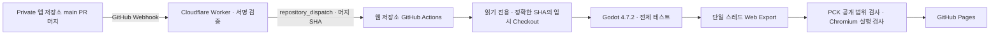

# Quiet solitaire experimental Web build

앱 프로젝트의 브라우저 실험을 위한 별도 배포 저장소입니다. 정식 웹 출시를 위한 제품 분기가 아닙니다.
게임 소스는 Private인 `neuma573/quiet-solitaire`에만 보관하고, 여기에는 Web Export 설정과 CI/CD만 관리합니다.

배포 주소: **https://neuma573.com/quiet-solitaire-web/**
https://neuma573.github.io/quiet-solitaire-web/ 는 계정의 기존 도메인으로 이동합니다.
이 실험용 Pages에만 HTTPS를 적용했고 다른 저장소의 도메인 설정은 변경하지 않았습니다.

## 자동 배포



- 원본의 `pull_request` Webhook 중 `closed`, `merged: true`, 대상 브랜치 `main`인 이벤트만 배포를 시작합니다. 주기적인 확인은 없습니다. main 직접 push는 이 실험의 자동 배포 대상이 아닙니다.
- Worker는 원문 요청의 `X-Hub-Signature-256`을 HMAC-SHA256으로 검증하고 원본 저장소 ID·이름·Private 여부와 머지 SHA를 확인합니다. 잘못된 서명, 다른 저장소와 미머지 이벤트로는 Actions를 호출하지 않습니다.
- Worker가 `source-main-merged` dispatch에 `merge_commit_sha`를 전달합니다. 원본 Webhook에는 Private PR 정보가 있지만 Public Actions에는 저장소 식별자·SHA·delivery ID만 전달합니다. Worker 요청 로그는 활성화하지 않습니다.
- 게시된 원본 SHA와 파이프라인 SHA가 같으면 다운로드·빌드·배포를 건너뜁니다.
- 확인한 40자리 SHA로 checkout합니다. 빌드 중 main이 바뀌면 오래된 결과는 게시하지 않습니다.
- 원본 공식 명령 `python3 scripts/test.py`의 전체 테스트, Web Export, PCK 공개 범위 검사와 실제 Chromium 검사를 통과한 결과만 게시합니다.
- 실패한 빌드는 게시 단계에 도달하지 않아 기존 사이트를 유지합니다. Pages 게시 실패도 기존 게시본을 교체하지 않습니다. 게시 후 HTTP 확인 실패와 게시 자체의 실패는 별도로 판단해야 합니다.
- `Actions → Deploy experimental Web build → Run workflow`로 즉시 확인할 수 있습니다. 선택적인 `source_sha`도 현재 main과 일치해야 게시됩니다.
- 웹 설정이 main에 바뀌면 재검증합니다. PR 검사는 원본 접근·게시 권한을 사용하지 않습니다.
- Worker를 수정한 경우 테스트 후 `npx wrangler deploy`로 별도 게시합니다. GitHub Pages 빌드에는 Cloudflare 인증이 필요하지 않습니다.

## 원본과 보안

원본에서 변경하는 것은 `quiet-solitaire`로의 저장소 이름 정리, 읽기 전용 Deploy Key와 Webhook 설정뿐입니다.
게임 코드, 기존 설정 파일, 브랜치, 커밋·태그 이력에 웹용 변경을 추가하지 않습니다.

| 인증 정보 | 저장 위치 | 범위 |
| --- | --- | --- |
| `SOURCE_DEPLOY_KEY` | 웹 저장소 Actions Secret | 원본 저장소 한 개의 Git 읽기 전용 |
| `WEBHOOK_SECRET` | Worker Secret 및 원본 Webhook 설정 | 이 Webhook의 HMAC 서명 검증 |
| `GITHUB_DISPATCH_TOKEN` | Worker Secret | Fine-grained PAT, 웹 저장소 한 개의 `Contents: Read and write` |
| 기본 `GITHUB_TOKEN` | Actions가 발급 | 빌드에서 Public 웹 저장소 `contents: read` |
| 배포 토큰/OIDC | Actions가 발급 | 별도 배포 job에서 `pages: write`, `id-token: write` |

SSH 호스트 키는 GitHub HTTPS API에서 받아 검증합니다. 개인 키는 해당 단계의 임시 경로에서 제거합니다.
원본 checkout은 runner 임시 경로에만 있으며, 게임 실행·테스트 단계에는 SSH 인증 정보를 전달하지 않습니다.
원본을 Public Git 이력이나 Actions cache에 올리지 않습니다. private 로그와 테스트 보고서는 runner에만 남으며 업로드하지 않습니다.
Pages artifact에는 공개 런타임 파일만 포함하고 보존 기간은 1일입니다.

WebAssembly·`.pck`·이미지·컴파일된 GDScript는 플레이에 필요한 공개 런타임입니다.
`.pck`는 다운로드·분석할 수 있으므로 웹 배포로 구현의 역분석까지 막을 수는 없습니다.
게시 전 파일 목록 검사로 원본 `.gd`, 테스트, 문서, 네이티브 플러그인과 개발 인증 파일의 포함을 거부합니다.
게임에는 서버 토큰이나 API 키를 넣지 않습니다.

## Webhook 연결과 복구

`wrangler.jsonc`와 `worker/index.mjs`에 수신기를 관리합니다. 브라우저 로그인은 다음 범위만 요청합니다.

수신 URL: `https://quiet-solitaire-web-webhook.quiet-solitaire-web-deployment.workers.dev/github`

```sh
npx wrangler login --scopes account:read user:read workers_scripts:write
npx wrangler deploy
```

Worker의 `/health`는 두 Secret이 설정됐을 때만 200을 반환합니다. Secret은 Wrangler의 `secret put` 또는 `secret bulk`로 저장하고 설정 파일·Git에 기록하지 않습니다.
원본 Settings → Webhooks에는 Worker의 `/github` URL, `application/json`, SSL 검증 활성화, `Pull requests` 이벤트와 동일한 HMAC Secret을 설정합니다.
실제 배포된 Worker URL과 Cloudflare 계정은 `wrangler deploy` 출력에서 확인할 수 있습니다.

원본 저장소 이름을 변경하면 `worker/index.mjs`와 `scripts/source.py`의 `SOURCE`도 함께 맞춥니다.
GitHub의 이전 주소 리디렉션은 Webhook·dispatch 본문의 저장소 이름 검사에 적용되지 않습니다.
이 참조를 바꿀 때는 웹 저장소의 main 반영과 Worker 재배포를 모두 완료해야 자동 배포가 연결됩니다.

GitHub 토큰은 소유자 `neuma573`, 저장소 `quiet-solitaire-web` 한 개와 `Contents: Read and write`만 선택합니다. 원본 읽기 권한은 별도의 읽기 전용 Deploy Key에 한정합니다.
GitHub API가 dispatch를 거부하면 Worker는 502를 반환합니다. GitHub Webhook은 실패 delivery를 자동 재시도하지 않으므로 원본 Settings → Webhooks → Recent Deliveries에서 원인을 해결한 뒤 Redeliver하거나 웹 저장소의 수동 실행을 사용합니다.
이미 게시됐거나 현재 main보다 오래된 SHA는 다시 게시하지 않습니다.

## Web Export 호환성

- 검토 원본은 `35615547ec5ef09a61cb5bc260355677b1c71a9c`로 고정합니다. 웹은 공식 **NanumSquare Regular v1.000 (160623_01)**와 기존 Noto Sans CJK KR fallback을 저장소에 포함하고 `web/font.json`의 SHA-256으로 검증합니다. Round·Neo를 사용하지 않으며 빌드와 플레이에 폰트 CDN을 요청하지 않습니다. 출처·버전·재배포 조건은 [폰트 기록](web/fonts/README.md)과 `web/FONT-LICENSE.txt`에 보존합니다.
- 적용 순서는 **읽기 전용 원본 → 원본 hook/XP 해시 검사 → 임시 복사본의 정확한 레이아웃 치환·결과 해시 검사 → 고정 웹 폰트 준비 → 원본 전체 회귀 → 보정 후 hook/XP 해시 검사 → 같은 복사본 export → 컴파일된 반응형 배치·브라우저 검사**입니다. `web/caption-compatibility.json`은 두 파일의 패치 전후 전체 해시와 각 치환의 정확한 단일 일치를 검사합니다. `web/leaderboard-compatibility.json`은 PR16의 `visuals.gd` 감시를 포함한 원본 계약과, 터치 영역 올림만 적용한 `main.gd`의 검토 후 해시를 구분합니다. 다른 SHA·파일·치환 조건이면 중단합니다.
- `9e7ad42… → 35615547…`의 변경 8파일을 검토했습니다. 게임·보드·통계·프로필·XP의 기존 감시 7파일은 동일하며, 새 거부 동작은 모드 선택 카드 시연에 한정됩니다. `visuals.gd`에는 설명 글자 크기와 거부 시연 대기 상수만 추가되어 반응형 보드가 사용하는 여백·간격·카드 비율 상수는 유지됩니다. 해당 파일의 전체 해시를 새 원본에 맞춰 갱신했으며, 관찰자·XP 계산·운영 API는 변경하지 않습니다. NanumSquare에서는 한국어 안내가 원래 342px 폭에 들어가므로 여백을 바꾸지 않습니다. 일본어는 올바른 fallback으로 렌더한 가장 긴 문구가 344px여서 모드 선택 화면의 일본어 좌우 여백만 24→23으로 보정합니다. Undo/Pause는 확대된 터치 영역을 정수 논리 좌표로 올려 Container 반올림의 중심 오차를 없앱니다. 글자 크기 16·번역·원본 assertion은 유지합니다.
- 원본 README, 설치 엔진과 공식 템플릿을 **Godot 4.7.2 stable**로 맞추고 공식 SHA256을 확인합니다. 원본 엔진 버전이 바뀌면 자동 배포를 중단하므로 `godot-version.json`을 검토해야 합니다.
- GDScript·GL Compatibility를 사용하며 WebAssembly·WebGL 2가 필요합니다. 스레드·GDExtension을 끕니다.
- 원본의 **390×760** 기준과 `canvas_items/expand` 배치를 사용합니다. 너비 600px 이하의 세로 창에서는 캔버스가 브라우저의 실제 가용 폭·높이를 채우고 Godot가 논리 화면을 넓히거나 높여 메뉴·마이페이지·보드를 재배치합니다. 320×568, 390×664처럼 짧은 화면도 높이에 맞춘 고정 화면의 좌우 레터박스를 남기지 않습니다. CSS와 렌더링 버퍼의 화면비를 맞추므로 카드 모양을 늘이거나 화면을 자르지 않습니다. 정수 렌더링 픽셀에 맞추면서 세로에만 기기 픽셀 1개 미만의 차이가 생길 수 있습니다. 브라우저 확대 중에는 layout viewport 폭을 기준으로 삼아 resize와 확대가 서로 증폭되지 않게 합니다.
- 짧고 넓은 세로 화면에서는 웹 전용 관찰자가 보드 높이에 맞춰 카드 열의 최대 폭을 제한하고 중앙에 둡니다. 숨은 카드 6장과 노출 카드 13장의 최장 열에서도 가용 높이 568px 이상인 검증 조합은 숫자·무늬 노출 높이 14 CSS px을 확보합니다. 가용 높이 460~504px인 작은 브라우저 화면에서는 기준 보드보다 카드를 작게 만들지 않고 기존 노출 높이를 보존합니다. 카드 비율·게임 규칙·입력 처리는 원본 그대로이며, 화면 배치 변경으로 게임 상태나 Undo 이력을 바꾸지 않습니다. 마이페이지의 긴 통계는 기존 세로 스크롤로 접근합니다. 게임이 직접 그리는 라이트·다크 배경이 캔버스 양 끝까지 채워지는 것을 검사하며 HTML 배경색을 통일해 여백을 가리지 않습니다.
- PC에서는 기존 390×760 크기를 중앙에 표시하고, 더 작은 가로 창에서는 같은 비율로 축소합니다. 데스크톱 전체 폭을 강제하지 않으며 좁은 세로 창에서는 동일한 모바일 규칙을 사용합니다. 변경은 웹 shell·웹 전용 관찰자에만 적용하고 원본 checkout과 프로젝트 설정은 수정하지 않습니다. 새로 사용하는 `visuals.gd`의 배치 상수도 호환성 해시로 고정해 미검토 변경을 거부합니다.
- 원본은 보드의 중복 입력을 막기 위해 터치의 마우스 에뮬레이션을 끕니다. Godot 4.7.2의 embedded `PopupMenu`는 마우스/키보드로 항목을 선택·닫기 때문에, 웹 브리지는 마이페이지 난이도 팝업이 표시될 때만 에뮬레이션을 켭니다. 닫힘·페이지 해제 시 원래 설정으로 복원하며, 바깥 누름으로 닫은 경우 해당 누름의 해제까지 전달한 뒤 복원해 눌린 포인터가 남지 않게 합니다. 게임 규칙·통계 필터·원본 파일과 소스 호환성 가드는 변경하지 않습니다.
- iOS 네이티브 설정·전환은 기존 Godot 폴백을 사용하고 Game Center는 사용할 수 없습니다. 네이티브 파일은 내보내지 않습니다.
- 깨끗한 checkout의 CSV 번역과 글꼴을 생성하기 위해 임시 복사본에서 번역 참조를 잠시 비우고 import합니다. 이후 번역 참조를 복원하고 웹 전용 테마를 적용한 상태로 원본의 공식 전체 테스트를 실행합니다. 같은 테마로 Web Export하며 원본 checkout과 게임 코드·번역·씬·테스트는 바꾸지 않습니다.
- `web/theme.tres`는 NanumSquare와 Noto Sans CJK를 묶고, Web의 `SystemFont`가 사용하는 기본 테마 글꼴도 지정합니다. NanumSquare가 일본어 코드포인트 일부를 빈 윤곽으로 매핑하므로 빈 routing anchor와 FontFile script 우선순위로 한자·히라가나·가타카나를 Noto에 연결합니다. Latin·한글은 NanumSquare를 사용하고 시스템 fallback은 차단합니다. Noto의 큰 기본 행 높이가 영어에도 적용되는 Godot 동작에 맞춰 `web/prepare_fonts.gd`에서 CJK의 행 상자를 1.25 em으로 설정하고, 일본어 버튼에는 글꼴의 비례 자간 기능 `palt`를 사용합니다. 글리프 크기와 다운로드한 폰트 데이터는 유지하며, 테스트의 최소 카드 공간 기준을 변경하지 않습니다.
- Linux 검증에서는 빌드별 Fontconfig를 빈 디렉터리로 제한하고 처리된 FontFile을 사용합니다. 원본 TTF를 Fontconfig가 직접 검색해 script 설정을 우회하지 않도록 합니다. runner에 설치된 시스템 글꼴에 따라 레이아웃 결과가 달라지지 않게 하며 시스템 전체의 글꼴 설정은 바꾸지 않습니다. 웹 글꼴 설정은 회귀 테스트와 내보내기에 동일하게 적용합니다.
- 임시 복사본의 iOS export preset은 Web preset으로 대체합니다. 배포에는 script 설정과 행 높이를 처리한 글꼴 리소스를 포함하며 준비에 사용한 원본 TTF·OTF를 중복으로 넣지 않습니다.
- 브라우저는 원본의 시스템 폰트를 제공하지 않아 웹 글꼴이 필요합니다. 공식 NanumSquare와 기존 Noto의 고정 파일을 웹 저장소에 포함하고 `web/font.json`의 SHA256으로 검증합니다. 저작권 고지와 SIL OFL 1.1 전문은 배포물의 `FONT-LICENSE.txt`에 포함하며 원본에는 폰트를 추가하지 않습니다.
- 런타임 배치 JSON 두 개(`assets/deals/draw-1-decks.json`, `assets/deals/draw-3-decks.json`)는 Web preset에서 명시적으로 포함합니다. PCK 검사는 둘 중 하나라도 빠지거나 다른 JSON(개발용 해답 포함)이 들어가면 게시를 거부합니다.
- PWA·오프라인 캐시는 추가하지 않습니다. 원본과 동일하게 진행 중인 게임 재개 저장은 없으며 설정·통계 보존은 브라우저 IndexedDB 정책의 영향을 받습니다.
- Chromium에서 실제 실행을 확인합니다. iPhone Safari의 성능·터치·안전 영역, VoiceOver는 별도 실기기 검증 대상입니다.

## 독립 리더보드 페이지

`/quiet-solitaire-web/leaderboard/`는 게임 엔진을 불러오지 않는 가벼운 반응형 순위 페이지입니다.
데스크톱과 모바일에서 누적 XP 상위 25명의 순위·닉네임·XP를 표시합니다.
게임의 마이페이지 리더보드에는 별도 페이지를 새 탭으로 여는 링크가 있고,
순위 페이지에서는 상단의 **게임으로** 링크로 돌아갈 수 있습니다.

- 기존 `GET /v1/leaderboard?limit=25` 응답을 읽기만 하며, 게스트 생성·가입·닉네임 변경은 하지 않습니다.
- `web/leaderboard-config.json` 한 개를 게임과 공유합니다. `apiBase`가 비어 있으면
  실제 순위 대신 서버 연결 준비 안내를 표시하고 API를 호출하지 않습니다. 샘플 순위는 게시하지 않습니다.
- 불러오는 중·기록 없음·연결 오류·응답 시간 초과를 구분하며 오류 후 다시 시도할 수 있습니다.
- 공개 파일은 `scripts/build.py`의 명시적 허용 목록으로만 복사합니다.
  `web/leaderboard/`가 페이지이고, 저장소 루트의 `leaderboard/`는 비공개 배포용 서버 코드입니다.
- 순위는 기존 서버의 XP 내림차순과 동점 순서를 유지합니다. 스키마나 순서가 잘못된 응답은 표시하지 않습니다.
- 위 경로는 이 변경을 main에 반영하고 기존 배포 검사를 통과한 뒤 제공됩니다.

페이지·API 응답 테스트와 실제 Chromium 검사는 다음 명령으로 실행합니다.
브라우저 검사에 등장하는 순위는 가로챈 로컬 테스트 데이터이며 실제 순위가 아닙니다.

```sh
node --test tests/*.test.mjs
node tests/leaderboard-page-browser.mjs
# 전체 Godot 빌드 결과의 하위 경로와 자산 검사
node tests/leaderboard-page-browser.mjs --directory /path/to/export
```

## 웹 리더보드

리더보드는 **누적 XP 내림차순**이며 순위·닉네임·XP만 표시합니다. 서버가 랜덤 닉네임과
별도 고유 ID를 발급하므로 닉네임을 바꿔도 ID와 XP는 유지됩니다. 게임을 열면 기존 쿠키를 복원하거나
새 게스트를 자동 발급합니다. 연결 뒤 새로 시작한 게임의 승리 XP만 서버에서 지급량을 계산해
누적하며, 기존 로컬 통계는 업로드하지 않습니다.

- `web/leaderboard_bridge.gd`는 웹 빌드의 임시 복사본에만 추가하는 관찰용 autoload입니다.
  원본 게임 코드와 커밋은 변경하지 않습니다. 기존 마이페이지의 웹 전용 버튼으로 리더보드를 열고 닉네임을 수정합니다.
  게임의 시간·이동 수 표시를 가리지 않도록 게임 shell에서는 별도의 떠 있는 실행 버튼을 숨깁니다.
- `leaderboard/`는 별도의 게임 API와 D1 스키마입니다. `worker/`와 루트 `wrangler.jsonc`의
  기존 GitHub 웹훅, 토큰, 배포 책임은 공유하지 않습니다.
- `web/leaderboard-config.json`은 게임과 순위 페이지를 배포된
  `https://solitaire-api.neuma573.com` API에 연결합니다. 이 설정은 main 병합 후 웹 배포부터 적용됩니다.
  `apiBase`가 있으면 게임의 게스트 연결은 자동이며, 빈 문자열로 되돌리면 API 호출 없이 준비 안내를 표시합니다.
  실제 서버 설정과 검증 범위는 [리더보드 설정 문서](leaderboard/README.md)를 참조하세요.
- 게스트는 HttpOnly 쿠키로 인증합니다. 닉네임이나 클라이언트가 보낸 ID로 쓰기를 인증하지 않습니다.
  쿠키 삭제·브라우저 변경·다른 기기에서는 기존 ID와 XP를 복구할 수 없으며 로그인 기능은 없습니다.
- 신규 자동 닉네임은 형용사 32개 × 동물명 32개 × `000`~`999` 조합으로 1,024,000가지입니다.
  예: `포근한 고양이042`. 기존 저장 이름은 바꾸지 않습니다. 이 기본값 변경은 별도 API Worker 배포 후 적용됩니다.
- 인게임 화면은 고유 ID·닉네임 변경·`나의 모든 기록 삭제`를 제공합니다. 삭제 확인 후 공유 리더보드의
  게스트·닉네임·XP·서버 기록을 삭제하며 기기의 게임 저장·통계는 유지합니다. 바로 새 게스트를 만들지 않고
  다음 페이지 로드에서 새 ID로 시작합니다. 순위의 `새로고침`은 기록 초기화가 아닙니다.
- 서버의 지급량 계산·중복 지급 방지·기본 요청 제한은 포함하지만, 브라우저의 승리 보고 자체를
  증명하지는 않습니다. 결과는 클라이언트 신고 기록입니다. 상금이나 경쟁 대회의 검증 수단으로 사용할 수 없습니다.
- 게임 연결은 검토한 원본 SHA와 소스 계약을 확인하고 실패 시 빌드를 중단합니다. 원본 SHA가 바뀌면
  `web/leaderboard-compatibility.json`과 어댑터를 다시 검토해야 합니다.

실제 로컬 Workers/D1와 전체 원본 테스트·Web Export·PCK·1×/2× 실행 검사를 통과했습니다.
초기 WSL 메뉴 테스트 실패는 실행 파일·사용자 데이터·로그까지 Linux 네이티브 경로에 둔
환경에서 원본 수정 없이 해소됐습니다. 환경 비교와 재현 명령은 [검증 기록](leaderboard/VERIFICATION.md)에 기록했습니다.

추가 검증:

```sh
node --test tests/*.test.mjs
python3 -m unittest discover -s tests -v
# Playwright 설치 후 선택적으로 실행 (모든 HTTPS 요청을 로컬에서 가로채며 외부 통신 없음)
node tests/leaderboard-ui-browser.mjs
node tests/leaderboard-api-browser.mjs
# 실제 공개 compiled PCK의 26개 배치·흑백·긴 열·드래그/Undo 검사
python3 scripts/check_responsive_layout.py --directory /path/to/export --godot /path/to/godot
# 실제 Web Export의 마이페이지 연결 검사
node tests/leaderboard-export-browser.mjs --directory /path/to/export
# 실제 HTTP에서 터치/마우스 팝업·HTML 포커스 복귀·팝업 해제 후 보드 입력 검사
node tests/profile-input-browser.mjs --directory /path/to/export --screenshots /tmp/profile-input
# WebKit 모바일 에뮬레이션 (실제 iPhone/Android 실기기 검증과 구분)
npx playwright install webkit
node tests/profile-input-browser.mjs --browser webkit --directory /path/to/export --screenshots /tmp/profile-webkit
# 배포본의 같은 결함 재현 (게스트 API 쓰기 없음)
node tests/profile-input-browser.mjs --url https://neuma573.com/quiet-solitaire-web/
```

`GODOT_BIN`을 설정하면 Python 검증에 실제 Godot 어댑터 수명주기 검사도 포함됩니다.
브라우저 검사는 `CHROME_BIN`으로 설치된 Chromium 계열 브라우저를 지정할 수 있습니다.
API 브라우저 검사는 실제 핸들러와 SQLite를 사용하지만 Cloudflare 런타임·배포 검사를 대신하지는 않습니다.
`ci/**` 검증은 Linux에서 원본 테스트·export·Chromium 검사를 통과한 동일 공개 런타임을
macOS로 가져와 WebKit의 터치·포커스·게임 입력을 검사합니다. Ubuntu WebKit에서는 모든 입력 assertion이
통과한 뒤 `glBlitFramebuffer` 검증 오류가 수집되어 실패했으므로, Linux WebKit까지 검증됐다고 주장하지 않습니다.
macOS WebKit 검사도 모든 콘솔·Godot·자산 오류를 실패로 처리하며 오류 예외 목록을 추가하지 않습니다.

## 로컬 빌드 검증

```sh
python3 -m unittest discover -s tests -v
node --test tests/worker.test.mjs
npm ci --ignore-scripts
npx wrangler deploy --dry-run --outdir /tmp/quiet-web-worker-check
npx playwright install chromium
```

원본을 별도 checkout하고 비어 있는 출력 경로를 지정합니다. 설치된 Godot와 Web export templates는 같은 4.7.2 버전이어야 합니다.

```sh
python3 scripts/build.py --source /path/to/private-checkout --output /tmp/quiet-web-site --godot /path/to/godot
node scripts/smoke.mjs --directory /tmp/quiet-web-site
node scripts/smoke.mjs --directory /tmp/quiet-web-site --locale ja-JP --screenshot /tmp/quiet-web-ja.png
node scripts/smoke.mjs --url https://neuma573.com/quiet-solitaire-web/
```

macOS에 템플릿을 전역 설치하지 않으려면 `build.py`에 공식 `web_nothreads_release.zip` 경로를 `--template`로 전달합니다.
로컬 진단은 출력 경로 옆 `quiet-private-diagnostics-*`에 있으며 Public 저장소에 올리지 않습니다.
Linux Actions에서는 엔진·템플릿을 runner 임시 경로에 설치합니다.

## 실험 중단과 키 회전

중단할 때는 원본의 실험용 Webhook과 웹 저장소의 배포 워크플로를 비활성화하거나 Pages를 해제하면 됩니다.
dispatch 토큰은 GitHub에서 폐기하고 Worker Secret을 제거합니다. HMAC 키는 Worker Secret과 원본 Webhook 설정을 함께 교체합니다.
원본 읽기 권한은 원본 Settings → Deploy keys의 `quiet-solitaire-web experimental CI (read-only)`를 삭제해 폐기합니다.
회전할 때는 새 읽기 전용 키를 원본에 등록하고 웹 저장소 Secret을 교체한 다음 기존 키를 삭제합니다.
이 작업은 원본의 앱 개발·빌드에 영향을 주지 않습니다.

공식 참고: [GitHub Pages workflows](https://docs.github.com/en/pages/getting-started-with-github-pages/using-custom-workflows-with-github-pages),
[GitHub Webhook signature validation](https://docs.github.com/en/webhooks/using-webhooks/validating-webhook-deliveries),
[Godot 4.7 Web export](https://docs.godotengine.org/en/4.7/tutorials/export/exporting_for_web.html).

