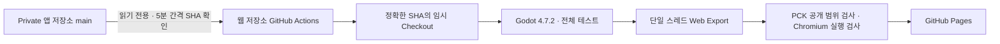

# Quiet solitare experimental Web build

앱 프로젝트의 브라우저 실험을 위한 별도 배포 저장소입니다. 정식 웹 출시를 위한 제품 분기가 아닙니다.
게임 소스는 Private인 `neuma573/quiet-solitare`에만 보관하고, 여기에는 Web Export 설정과 CI/CD만 관리합니다.

배포 주소: **https://neuma573.com/quiet-solitaire-web/**
https://neuma573.github.io/quiet-solitaire-web/ 는 계정의 기존 도메인으로 이동합니다.
이 실험용 Pages에만 HTTPS를 적용했고 다른 저장소의 도메인 설정은 변경하지 않았습니다.

## 자동 배포



- 매시 3, 8, 13, …, 58분에 원본 main을 확인합니다. GitHub 예약 실행은 지연되거나 누락될 수 있어 Push 직후 실행을 보장하지 않습니다.
- main merge와 직접 push 모두 감지합니다. 확인 사이에 여러 변경이 발생하면 최신 SHA만 배포합니다.
- 게시된 원본 SHA와 파이프라인 SHA가 같으면 다운로드·빌드·배포를 건너뜁니다.
- 확인한 40자리 SHA로 checkout합니다. 빌드 중 main이 바뀌면 오래된 결과는 게시하지 않습니다.
- 원본 공식 명령 `python3 scripts/test.py`의 전체 테스트, Web Export, PCK 공개 범위 검사와 실제 Chromium 검사를 통과한 결과만 게시합니다.
- 실패한 빌드는 게시 단계에 도달하지 않아 기존 사이트를 유지합니다. Pages 게시 실패도 기존 게시본을 교체하지 않습니다. 게시 후 HTTP 확인 실패와 게시 자체의 실패는 별도로 판단해야 합니다.
- `Actions → Deploy experimental Web build → Run workflow`로 즉시 확인할 수 있습니다. 선택적인 `source_sha`도 현재 main과 일치해야 게시됩니다.
- 웹 설정이 main에 바뀌면 재검증합니다. PR 검사는 원본 접근·게시 권한을 사용하지 않습니다.
- 외부 Webhook이 없으므로 Webhook 서명, Cloudflare Worker, dispatch PAT가 필요하지 않습니다. 인증된 `repository_dispatch`도 선택적으로 지원하지만 기본 자동화는 예약 확인입니다.

활동이 없는 Public 저장소의 예약 워크플로는 GitHub가 60일 후 비활성화할 수 있습니다. 실험을 오래 사용하지 않았다면 Actions에서 다시 활성화하세요.

## 원본과 보안

원본에서 변경한 것은 `quite-solitare` → `quiet-solitare` 이름과 읽기 전용 Deploy Key 설정뿐입니다.
게임 코드, 기존 설정 파일, 브랜치, 커밋·태그 이력에 웹용 변경을 추가하지 않습니다.

| 인증 정보 | 저장 위치 | 범위 |
| --- | --- | --- |
| `SOURCE_DEPLOY_KEY` | 웹 저장소 Actions Secret | 원본 저장소 한 개의 Git 읽기 전용 |
| 기본 `GITHUB_TOKEN` | Actions가 발급 | 빌드에서 Public 웹 저장소 `contents: read` |
| 배포 토큰/OIDC | Actions가 발급 | 별도 배포 job에서 `pages: write`, `id-token: write` |

SSH 호스트 키는 GitHub HTTPS API에서 받아 검증합니다. 개인 키는 해당 단계의 임시 경로에서 제거합니다.
원본 checkout은 runner 임시 경로에만 있으며, 게임 실행·테스트 단계에는 SSH 인증 정보를 전달하지 않습니다.
원본을 Public Git 이력이나 Actions cache에 올리지 않습니다. private 로그와 테스트 보고서는 runner에만 남으며 업로드하지 않습니다.
Pages artifact에는 공개 런타임 파일만 포함하고 보존 기간은 1일입니다.

WebAssembly·`.pck`·이미지·컴파일된 GDScript는 플레이에 필요한 공개 런타임입니다.
`.pck`는 다운로드·분석할 수 있으므로 웹 배포로 구현의 역분석까지 막을 수는 없습니다.
게시 전 파일 목록 검사로 원본 `.gd`, 테스트, 문서, 네이티브 플러그인과 개발 인증 파일의 포함을 거부합니다.
게임에는 서버 토큰이나 API 키를 넣지 않습니다.

## Web Export 호환성

- 원본 README, 설치 엔진과 공식 템플릿을 **Godot 4.7.2 stable**로 맞추고 공식 SHA256을 확인합니다. 원본 엔진 버전이 바뀌면 자동 배포를 중단하므로 `godot-version.json`을 검토해야 합니다.
- GDScript·GL Compatibility를 사용하며 WebAssembly·WebGL 2가 필요합니다. 스레드·GDExtension을 끕니다.
- iOS 네이티브 설정·전환은 기존 Godot 폴백을 사용하고 Game Center는 사용할 수 없습니다. 네이티브 파일은 내보내지 않습니다.
- 깨끗한 checkout의 CSV 번역을 생성하기 위해 임시 복사본에서 번역 참조를 잠시 비우고 import한 뒤 원래 `project.godot` 바이트를 복원합니다. 이후 공식 전체 테스트를 실행하고 원본 checkout은 바꾸지 않습니다.
- 임시 복사본의 iOS export preset을 Web preset으로 대체하고, `gui/theme/custom_font`로 Noto Sans CJK를 폴백 폰트에 지정합니다. 게임 코드·번역·씬은 수정하지 않습니다.
- 브라우저는 원본의 시스템 폰트를 제공하지 않아 CJK 폰트가 필요합니다. 폰트는 고정된 공식 notofonts 커밋에서 다운로드하고 SHA256을 검증합니다. SIL OFL 1.1 전문은 배포물의 `FONT-LICENSE.txt`에 포함하며 원본에는 폰트를 추가하지 않습니다.
- PWA·오프라인 캐시는 추가하지 않습니다. 원본과 동일하게 진행 중인 게임 재개 저장은 없으며 설정·통계 보존은 브라우저 IndexedDB 정책의 영향을 받습니다.
- Chromium에서 실제 실행을 확인합니다. iPhone Safari의 성능·터치·안전 영역, VoiceOver는 별도 실기기 검증 대상입니다.

## 로컬 검증

```sh
python3 -m unittest discover -s tests -v
npm ci --ignore-scripts
npx playwright install chromium
```

원본을 별도 checkout하고 비어 있는 출력 경로를 지정합니다. 설치된 Godot와 Web export templates는 같은 4.7.2 버전이어야 합니다.

```sh
python3 scripts/build.py --source /path/to/private-checkout --output /tmp/quiet-web-site --godot /path/to/godot
node scripts/smoke.mjs --directory /tmp/quiet-web-site
node scripts/smoke.mjs --url https://neuma573.com/quiet-solitaire-web/
```

macOS에 템플릿을 전역 설치하지 않으려면 `build.py`에 공식 `web_nothreads_release.zip` 경로를 `--template`로 전달합니다.
로컬 진단은 출력 경로 옆 `quiet-private-diagnostics-*`에 있으며 Public 저장소에 올리지 않습니다.
Linux Actions에서는 엔진·템플릿을 runner 임시 경로에 설치합니다.

## 실험 중단과 키 회전

중단할 때는 웹 저장소의 배포 워크플로를 비활성화하거나 Pages를 해제하면 됩니다.
원본 읽기 권한은 원본 Settings → Deploy keys의 `quiet-solitaire-web experimental CI (read-only)`를 삭제해 폐기합니다.
회전할 때는 새 읽기 전용 키를 원본에 등록하고 웹 저장소 Secret을 교체한 다음 기존 키를 삭제합니다.
이 작업은 원본의 앱 개발·빌드에 영향을 주지 않습니다.

공식 참고: [GitHub Pages workflows](https://docs.github.com/en/pages/getting-started-with-github-pages/using-custom-workflows-with-github-pages),
[Actions schedule limitations](https://docs.github.com/en/actions/reference/workflows-and-actions/events-that-trigger-workflows#schedule),
[Godot 4.7 Web export](https://docs.godotengine.org/en/4.7/tutorials/export/exporting_for_web.html).
